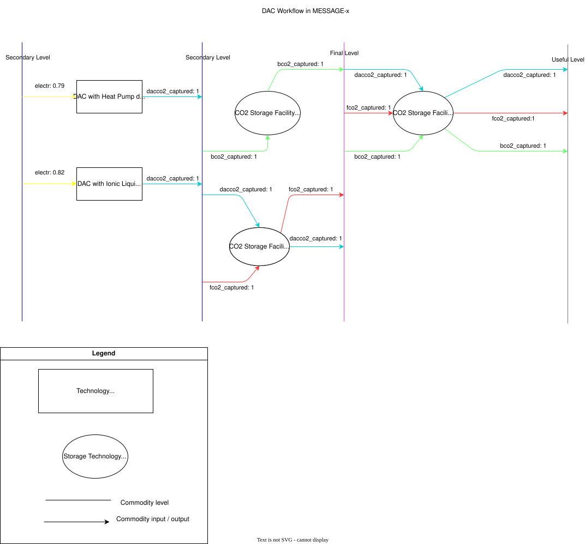

# Model Input & Assumptions

Each scenario file includes sets and parameters used in the model. Many of these input data points are already reported in the output files, such as **efficiency, technical lifetime, and operation & maintenance (O&M) costs for technologies**.

For certain sheets where data sources and assumptions are required, they are documented below. For a detailed explanation of each set or parameter used in the core model formulation, refer to the following documentation:

- **Sets**: [MESSAGE Sets and Mappings](https://docs.messageix.org/en/latest/model/MESSAGE/sets_maps_def.html#)
- **Parameters**: [MESSAGE Parameters](https://docs.messageix.org/en/latest/model/MESSAGE/sets_maps_def.html#)

For the name and descrion of the MESSAGE commodities, technologies and relations:

* [Technologies](https://docs.messageix.org/projects/models/en/latest/pkg-data/codelists.html#technologies-technology-yaml)
  * For new technologies that are added in the model. See below.
* [Commodities](https://docs.messageix.org/projects/models/en/latest/pkg-data/codelists.html#commodities-commodity-yaml)
* [Relations](https://docs.messageix.org/projects/models/en/latest/pkg-data/relation.html)
* [Emission Species](https://docs.messageix.org/projects/models/en/latest/pkg-data/codelists.html#emission-species-emission-yaml)

### **📊 Data Sources and Assumptions**

The table below summarizes the data sources used for different input parameters:

| **Data Type**                       | **Sheet Name(s)**                                                                                                                     | **Description**                                                                                                                                                                                                                                                                                                                                             |
| ----------------------------------------- | ------------------------------------------------------------------------------------------------------------------------------------------- | ----------------------------------------------------------------------------------------------------------------------------------------------------------------------------------------------------------------------------------------------------------------------------------------------------------------------------------------------------------------- |
| **Costs**                           | `inv_cost`, `fix_cost`, `var_cost`                                                                                                    | Cost data is sourced from**WEO data**, fuel blending, and energy demands. For more details, refer to the MESSAGEix-GLOBIOM documentation [page](https://docs.messageix.org/projects/global/en/latest/energy/tech.html). At this point, there is no provinciial differentiation in technology costs but future work will explore varying technological costs.  |
| **Energy Resources**                | `historical_activity`, `bound_activity_up`                                                                                              | Historical oil and gas production data is sourced from**[Canada Energy Future](https://www.cer-rec.gc.ca/en/index.html)**. Maximum production is constrained based on federal current measures assumptions. Data and processing scripts are available in `data/oil_gas_production`.                                                                                |
| **Energy End-Use**                  | `initial_activity_lo`, `growth_activity_lo`, `growth_activity_up`, `initial_activity_up`                                            | Eneergy edn use asumptions growth rates and diffusion rates are based on SSP2 assumptions. For more details on the assumptions and how end-use technologies are mapped to useful demands refer to the documentation[page](https://docs.messageix.org/projects/global/en/latest/energy/enduse/index.html).                                                           |
| **Population and GDP**              | `bound_activity_lo`, `bound_activity_up`                                                                                                | Population projections for provinces are sourced from**Statistics Canada** (till 2048) and projected till 2060 using linear regression. GDP projections apply federal growth rate predictions to current provincial GDP values.                                                                                                                             |
| **Energy Service Demands**          | `demand`                                                                                                                                  | Energy demands are calculated using population and GDP data (`data/population` and `data/gdp`).                                                                                                                                                                                                                                                               |
| **Power Plant Capacity**            | `historical_new_capacity`, `bound_new_capacity_lo`, `bound_new_capacity_up`, `bound_total_capacity_lo`, `bound_total_capacity_up` | Data from**CODERS**. Vintage years are used to bound new capacity installations based on the technical lifetime of each technology.                                                                                                                                                                                                                         |
| **Renewable Energy Potentials**     | `renewable_potential`                                                                                                                     | Based on**gridded capacity factors** from CODERS data. The maximum producible solar, onshore wind, and offshore wind energy are multiplied by capacity factors.                                                                                                                                                                                             |
| **Historical Generation & End-Use** | `historical_activity`                                                                                                                     | Calibrated using**CER current measures**, mapped appropriately to individual technologies.                                                                                                                                                                                                                                                                  |
|                                           |                                                                                                                                             |                                                                                                                                                                                                                                                                                                                                                                   |

---

# **📉 Emissions Accounting**

The model employs **two types of emissions accounting**:

## **1️⃣ Top-Down (Extraction-Level) Accounting**

- Used for **carbon pricing** and **emission constraints**.
- Parameterized in the relation **`CO2_emission`**.
- **Positive values** correspond to **extraction and import technologies**.
- **Negative values** correspond to **mitigation technologies** (e.g., **CCS**).
- The `CO2_emission` relation assigns an **`emission_factor`** to technologies, categorized under the **emission type `TCE`**.
- By applying an upper **bound on `TCE`**, the model determines which technologies contribute to emissions.

## **2️⃣ Bottom-Up (Process-Level) Accounting**

- Tracks emissions at the **process level** within the system.
- Includes **technological groupings** for:
  - **CH₄ (Methane)**
  - **N₂O (Nitrous Oxide)**
  - **HFCs (Hydrofluorocarbons)**
- **Land-use emissions** are **not parameterized** in this model.

---

## **📊 Emission Factors and Calculations**

- The **emission factors** for fuels are mentioned alongwith references in the [MESSAGEix-GLOBIOM documnentation](https://docs.messageix.org/projects/global/en/latest/emissions/message/index.html)
- In **MESSAGEix-Canada**, the **emission factor** for each power plant is based on **fuel input values**.
  - Example: For a **coal power plant**, the **CO₂_CC** relation value needs to be **multiplied by the fuel input** (`coal_ppl`) to determine emissions.

# **📉 Emissions Calculation**

The model employs **two types of emissions accounting**:

## **1️⃣ Top-Down (Extraction-Level) Accounting**
- Used for **carbon pricing** and **emission constraints**.
- Parameterized in the relation **`CO2_emission`**.
- **Positive values** correspond to **extraction and import technologies**.
- **Negative values** correspond to **mitigation technologies** (e.g., **CCS**).
- The `CO2_emission` relation assigns an **`emission_factor`** to technologies, categorized under the **emission type `TCE`**.
- By applying an upper **bound on `TCE`**, the model determines which technologies contribute to emissions.

## **2️⃣ Bottom-Up (Process-Level) Accounting**
- Tracks emissions at the **process level** within the system.
- Includes **technological groupings** for:
  - **CH₄ (Methane)**
  - **N₂O (Nitrous Oxide)**
  - **HFCs (Hydrofluorocarbons)**
- **Land-use emissions** are **not parameterized** in this model.

---

## **📊 Emission Factors and Calculations**
- The **emission factors** for fuels are available in the MESSAGEix documentation:  
  🔗 [MESSAGEix Emission Factors](https://docs.messageix.org/projects/global/en/latest/emissions/message/index.html)
- In **MESSAGEix-Canada**, the **emission factor** for each power plant is based on **fuel input values**.  
  - Example: For a **coal power plant**, the **CO₂_CC** relation value needs to be **multiplied by the fuel input** (`coal_ppl`) to determine emissions.

### **🔢 Carbon Equivalency**
- The model **expresses emissions in carbon (C-equivalent)** rather than **CO₂-equivalent**.
- **Conversion formula**:  
  \[
  1 \text{ tonne CO₂} = 1 \times \left(\frac{12}{44}\right) = 0.27 \text{ tonnes carbon (C)}
  \]
  - The remaining **0.73 tonnes** account for **oxygen**.

---

## **📌 Example: Coal Power Plant Emissions Calculation**
To compute **fuel-related emission factors** for a coal power plant:

| **Relation**                           | **Value**       |
|----------------------------------------|----------------|
| `CO2_cc` (CO₂ emission factor)        | **2.11979**    |
| Coal power plant efficiency            | **\(1 / 2.63158 = 0.379\)** |
| **Emission factor of coal power plant** | **\(2.11979 \times 0.379 = 0.8044\) MtC/GWyr** |

> **🔹 Note:** The `CO2_cc` relation is **not used for emission constraints**. Instead, emission constraints are applied through **`CO2_emission`** and `TCE`.

---

## **🔄 Emission Bound Conversion**
Since model constraints are applied in **C-equivalent**, emission bounds must be **converted** accordingly:
\[
\text{Emission bound} \times \frac{12}{44}
\]

---

# **⚡ Hydrogen Modeling**
- Hydrogen technologies are included in the model with a focus on:
  - **Hydrogen production**
  - **Hydrogen storage**
  - **Hydrogen transportation**
- The key relations used in hydrogen modeling include:
  - `H2_production`
  - `H2_storage`
  - `H2_transport`

Hydrogen production is modeled with specific **conversion efficiencies** and **emission factors** based on feedstock type (e.g., electrolysis, SMR with or without CCS).

---

# **🌍 Direct Air Capture (DAC)**
- **DAC (Direct Air Capture)** is modeled as a **negative emissions technology**.
- It extracts CO₂ directly from the atmosphere and is parameterized in the relation:
  - `DAC_CO2_removal`
- The DAC process requires:
  - **Energy input**
  - **CO₂ separation and compression**
  - **Storage or utilization of captured CO₂**
- The effectiveness of DAC depends on:
  - **Technology efficiency**
  - **Energy requirements**
  - **CO₂ capture rate**

- The net-zero scenario that incorporates direct air capture technologies as part of  emission-mitigating technology. The infrastructure for accomodating such technologies counts on CO2 storage facilities paired with the extraction technologies, as examplified by the figure below.

