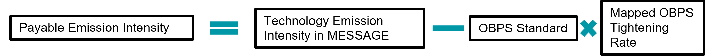

# Policies

*OBPS*

Canada's Output-Based Pricing System (OBPS) is a federal policy aimed at reducing greenhouse gas emissions from large industrial facilities while maintaining their competitiveness. Instead of paying a blanket carbon tax, facilities under the OBPS are assigned emissions-intensity performance standards based on their production output. Facilities emitting below their assigned limit earn surplus credits, which can be sold or saved for future use. Those exceeding the limit must compensate by purchasing credits or paying a fee aligned with the federal carbon price.

More information on the OBPS policy can be found at https://www.canada.ca/en/environment-climate-change/services/climate-change/pricing-pollution-how-it-will-work/output-based-pricing-system.html

***Model Implementation***

In Messageix-Canada, the OBPS framework is incorporated by first developing a payable emission intensity. OBPS emission standards are mapped to individual technologies within the MESSAGEix-Canada model. The difference between the OBPS emission standard and a technologies emission intensity is the payable emission intensity. For years after 2023, the OBPS standard is decreased by a legislated and mapped tightening rate to further tax large emitters in the model, as the policy was designed. For model years past 2035, it is assumed that the policy remains active and tightening rates continue to grow following the same trends as before 2035. However, as with many other aspects of the model, users have the ability to vary the tightening rates to explore future scenarios. Where applicable, provinces that have specified their own standards and tightening rates have been mapped and applied. This includes Alberta, British Columbia, New Brunswick, Nova Scotia, Newfoundland and Labrador, Ontario, and Saskatchewan.

This payable emission intensity is then multiplied by the federal carbon price to create cost that is then applied to the mapped MESSAGEix-Canada technologies for each respective temporal period. Like the OBPS tightening rates, it is assumed that federal carbon price will continue to grow post 2035 at the same specified rate as before 2035.

As MESSAGEix-Canada is unable to depict revenue streams, credits must be depicted a different way. When OBPS mapped technologies have a lower emission intensity then the OBPS emission standards a negative “receivable emission intensity” can be defined. The amount of “payable” and “receivable” emission intensities can then be tracked. Through an iterative process, the credit price was varied until supply and demand of credits roughly matched in the model results.

