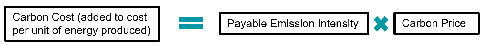

# Policies

## *OBPS*

Canada's Output-Based Pricing System (OBPS) is a federal policy aimed at reducing greenhouse gas emissions from large industrial facilities while maintaining their competitiveness. Instead of paying a blanket carbon tax, facilities under the OBPS are assigned emissions-intensity performance standards based on their production output. Facilities emitting below their assigned limit earn surplus credits, which can be sold or saved for future use. Those exceeding the limit must compensate by purchasing credits or paying a fee aligned with the federal carbon price.

More information on the OBPS policy can be found at https://www.canada.ca/en/environment-climate-change/services/climate-change/pricing-pollution-how-it-will-work/output-based-pricing-system.html

***Model Implementation***

In Messageix-Canada, the OBPS framework is incorporated by first developing a payable emission intensity. OBPS emission standards are defined by selecting a technology to map to a standard, then utilizing that technologies emiision intensity and multiplying by a defined reduction as outlined in the OBPS policy.


A list of a MESSAGEix technologies mapped to create standards can be found below:

| **Standard**                                      | **Standard Technology** | **Description**                               |
| ------------------------------------------------------- | ----------------------------- | --------------------------------------------------- |
| **Mining & Ore Processing, Coal, Sub-bituminous** | coal_extr                     | Coal extraction                                     |
| **Electricity Generation, Solid Fuels**           | coal_ppl                      | Coal power plant                                    |
| **Oil & Gas, Natural Gas, Pipieline Quality**     | gas_extr_3                    | Natural Gas extraction from ...                     |
| **Final Energy, Industry, Feedstock**             | gas_fs                        | Natural Gas as an industry feedstock                |
| **Final Energy, Industry**                        | gas_i                         | Natural Gas use in industrial applications          |
| **Electricity Generation, Gaseous Fuels, New**    | gas_ppl                       | Natural Gas power plant                             |
| **Oil & Gas, Natual Gas, Transmission**           | gas_t_d                       | Gas transmission and distribution                   |
| **Oil & Gas, Hydrogen**                           | h2_smr                        | Hydrogen production through steam-methane reforming |
| **Oil & Gas, Natural Gas, Liquids**               | LNG_regas                     | Gasification of liquid natural gas                  |
| **Electricity Generation, Liquid Fuels**          | loil_ppl                      | Light oil power plant                               |
| **Chemical, Petrochemicals, High Value**          | meth_ng                       | Methanol production from natural gas                |
| **Oil & Gas, Crude Oil ,Heavys**                  | oil_extr_3                    | Oil extraction from ...                             |

The difference between the OBPS emission standard and a technologies emission intensity is the payable emission intensity. For years after 2023, the OBPS standard is decreased by a legislated and mapped tightening rate to further tax applicable tachnologies in the model, as the policy was designed. For model years past 2035, it is assumed that the policy remains active and tightening rates continue to grow following the same trends as before 2035. However, as with many other aspects of the model, users have the ability to vary the tightening rates to explore future scenarios. Where applicable, provinces that have specified their own standards and tightening rates have been mapped and applied. This includes Alberta, British Columbia, New Brunswick, Nova Scotia, Newfoundland and Labrador, Ontario, and Saskatchewan.


This payable emission intensity is then multiplied by the federal carbon price to createa carbon cost that is then applied to the mapped MESSAGEix-Canada technologies for each respective temporal period. Like the OBPS tightening rates, it is assumed that federal carbon price will continue to grow post 2035 at the same specified rate as before 2035, however this can be varried by users should one desire.



As MESSAGEix-Canada is unable to depict revenue streams, credits must be depicted a different way. When OBPS mapped technologies have a lower emission intensity then the OBPS emission standards a negative “receivable emission intensity” can be defined. The amount of “payable” and “receivable” emission intensities can then be tracked. Through an iterative process, the credit price was varied until supply and demand of credits roughly matched in the model results.


# Canada Electricity Regulation (CER) Implementation in MESSAGEix-Canada

## Overview

This documentation explains the integration of the **Canada Electricity Regulation (CER)** in the MESSAGEix-Canada energy system model. The CER policy enforces a direct emission intensity limit on electricity generation technologies and allows offset credit purchases to partially comply with the regulation. This implementation reflects the design principles of Canada's  **Clean Electricity Regulations** , as well as regional policy variants from provinces such as **British Columbia (BC)** and  **Alberta** .

## Objective

Ensure that electricity generation emissions remain within a specified emission intensity threshold (e.g., tCO₂/MWh), while enabling partial compliance through the use of  **carbon offset credits** .

---

## Methodology

### 1. Relation Setup

Two new relations are introduced:

* `cer_direct_emission_intensity` → Enforces the main emissions intensity constraint.
* `cer_offset_limit` → Limits the maximum share of emissions that can be offset using purchased credits.

### 2. Relation Construction

#### a. Emission Intensity Constraint

For each emitting technology:

* **+1** assigned to the emission flow technology (e.g., `CO2_TCE`)
* **-λ** assigned to the electricity-generating technology's output flow (e.g., `electr` at `secondary` level)

This defines a linear inequality:

```
(+1 * Emissions) - (λ * Electricity Output) <= 0
```

Example: If λ = 0.065 tCO₂/MWh, it is transformed to 0.5694 MtC/GWyr.

#### b. Offset Contribution Constraint

Offsets are included with **+1** values in the `cer_direct_emission_intensity` relation. Additionally, the `cer_offset_limit` relation limits the contribution of offset purchases:

```
Total Offsets <= 10% of total allowed emissions
```

This is applied by:

* **+1** for offset technologies
* **-0.1 * λ** for electricity-generating technologies

### 3. Bound Setup

Both relations are given a hard constraint by setting:

```yaml
relation_upper:
  value: 0
```

This ensures emissions must stay within the permissible limit, including the offset cap.

---

## Provincial Carbon Prices for Offsets

| Province         | CAD/tCO₂ (2025) | USD2010/tCO₂ |
| ---------------- | ---------------- | ------------- |
| Alberta          | 65               | 39.00         |
| British Columbia | 40               | 24.00         |
| Federal (Rest)   | 50               | 30.00         |

**Conversion Note:** 1 CAD2025 → 0.75 USD2025, then divided by 1.25 to convert to USD2010.

These are added via the `tax_emission` parameter.

## References

* [*Canada Clean Electricity Regulations*](https://www.canada.ca/en/services/environment/weather/climatechange/climate-plan/clean-electricity.html)
* Alberta TIER Regulation (Add Link)
* British Columbia Carbon Market (Add Link)

---

## Limitations

* **Vintaging not accounted** : The CER does not currently differentiate between newly built and existing plants based on their commissioning date.
* **Static Thresholds** : The emission limits are hardcoded per policy design but may require updating for future policy revisions.
* **Technology Classification** : Inclusion of partial CCS and hydrogen-based generation can be context-sensitive and may require modeler judgment.

---

## Conclusion

This implementation of the CER provides a structured and policy-aligned mechanism for regulating emissions from electricity generation, offering flexibility via offsets, and maintaining system integrity through capped compliance mechanisms. This feature allows MESSAGEix-Canada to simulate decarbonization pathways under federal and provincial constraints effectively.
